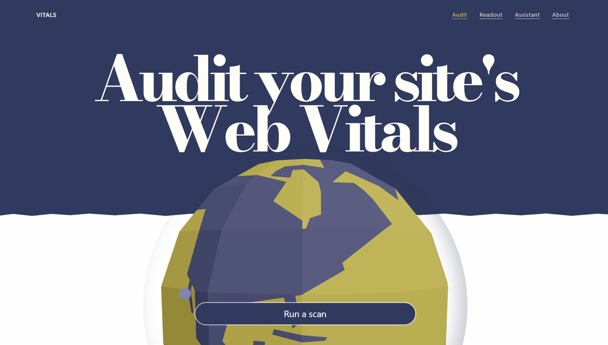
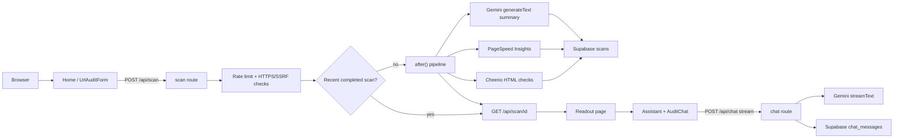

# Vitals

SEO and Core Web Vitals audits for a single URL, with a saved readout and a Gemini-backed assistant.

[](https://vitals-red-six.vercel.app/)
[](https://github.com/pughal-36/Vitals/actions/workflows/ci.yml)

## Hero screenshot



## Project brief

Vitals is a small production dashboard for people who need a first look at a page’s speed, accessibility, best-practices, and SEO signals before they change production. You paste an HTTPS URL; the app fetches the HTML, runs Google PageSpeed Insights, stores the result in Supabase, and can summarize or answer questions about that scan with Gemini. The idea is a single calibrated flow (Audit → Readout → Assistant) instead of bouncing between Lighthouse, docs, and a generic chatbot.

## Live demo

**URL:** [https://vitals-red-six.vercel.app/](https://vitals-red-six.vercel.app/)

What to try first:

1. On the home page, paste `https://example.com` (or use **Try an example: https://vercel.com**) and run **Scan**. Quick HTML checks appear first; category scores fill in as PageSpeed finishes.
2. Open **Readout** for the saved scores and failing audits, then **Assistant** and ask a follow-up (or use a suggested chip). Press **Escape** to stop a stream.
3. Open **Readout** or **Assistant** with no saved scan to see the empty state and **Back to Audit**.

## Key features

- Progressive scan pipeline: `POST /api/scan` returns quickly; work continues with Next.js `after()`, and the form polls `GET /api/scan/[scanId]` about every 2 seconds.
- Phase 1 HTML checks (title, meta description, H1, canonical, robots, image alt coverage) via Cheerio.
- Phase 2 PageSpeed Insights scores (Performance, Accessibility, Best Practices, SEO) plus Core Web Vitals excerpts and failing audits.
- Phase 3 Gemini summary stored on the scan (timeout 15s; failure leaves `summary` empty).
- 24-hour scan reuse with an explicit **Re-scan** that bypasses cache; 90-second stuck-scan timeout.
- HTTPS-only URL validation, SSRF blocks for private/internal hosts, and 15 scans per minute per IP.
- Scan id kept in the query string, `localStorage` (`vitals.scanId`), and a `scanId` cookie so Readout and Assistant restore context.
- Streaming assistant (`useChat` → `POST /api/chat`) with scan-aware system prompt, `fetchMetaTags` tool, suggested follow-up chips, Stop / Escape, and distinct offline / 429 / generic errors.
- Instrument-style Earth hero: Three.js globe on desktop, static SVG on small viewports or when WebGL fails / reduced motion.
- Static loading tips during a scan (curated list in `SeoLoadingTips`; no live tips API).
- Route-level error and not-found UI with **Try again** / **Back to dashboard**.

## Architecture

| Area | Role |
| --- | --- |
| `src/app` | App Router pages (`/`, `/readout`, `/assistant`, `/about`) and route handlers under `src/app/api`. |
| `src/components` | Scan form, globe, navigation, recent scans, loading tips. |
| `src/lib/scanner` | URL validation, in-memory rate limit, background pipeline. |
| `src/lib/gemini` | Gemini Flash model adapter and chat system prompt. |
| `src/lib/supabase` | Browser/server clients and scan/chat persistence. |
| `supabase/migrations` | Additive SQL for scan status, quick checks, summary, timings. |
| `audit/` | Before/after Lighthouse + axe-core reports and screenshots. |

Data flow:

1. `UrlAuditForm` posts the URL to `/api/scan`.
2. The handler validates, rate-limits, reuses a 24h cache when possible, otherwise inserts a pending row and schedules `runScanPipeline` in `after()`.
3. The pipeline fetches HTML, calls PageSpeed Insights, writes scores, then optionally generates a Gemini summary.
4. The client polls `/api/scan/[scanId]` until `done` or `failed`.
5. Readout loads the row from Supabase. Assistant loads the scan plus chat history, then streams through `/api/chat`.



## AI integration

**Model:** `gemini-3.6-flash` via `@ai-sdk/google` (`createGoogleGenerativeAI` with `VITALS_GEMINI_API_KEY`) in [`src/lib/gemini/model.ts`](src/lib/gemini/model.ts).

**Call sites**

- Chat: [`src/app/api/chat/route.ts`](src/app/api/chat/route.ts) uses `streamText` and `toUIMessageStreamResponse()`. Client: [`src/app/chat/AuditChat.tsx`](src/app/chat/AuditChat.tsx) (`useChat`).
- Scan summary: [`src/lib/scanner/pipeline.ts`](src/lib/scanner/pipeline.ts) uses `generateText` after scores are saved.

**Why an LLM is used:** PageSpeed JSON and failing audits are hard to read as a first pass. The model turns a saved scan into a short verdict plus Q&A, without blocking the scan HTTP response.

**Prompt structure**

Shared chat prompt [`AUDIT_SUMMARY_PROMPT`](src/lib/gemini/prompts.ts): consultant role, markdown, no fabricated scores, numbered fixes, and exactly three follow-ups inside `<chips>[...]</chips>`.

When a `scanId` cookie is present, the chat route prepends the scanned URL, four category scores, and up to five failing audits, then appends `AUDIT_SUMMARY_PROMPT`.

The pipeline summary prompt is inline in `pipeline.ts`: scores, selected vitals, quick checks, top failing audits → executive verdict, top 3 fixes, quick SEO wins, under 250 words.

**Structured output / validation**

- Chat user messages: reject missing, empty, or whitespace-only input (`400`, `invalid_input`).
- Tool `fetchMetaTags`: Zod `z.string().url()`; Cheerio extracts title/description/OG/canonical.
- Follow-up chips: JSON array inside `<chips>` parsed on the client; invalid JSON is ignored.
- Scan summary: plain markdown string stored on the row; no schema parse.

**Streaming:** Chat streams tokens to the UI. A Stop control and Escape abort the stream. `onError` mid-stream returns a generic string and does not leak stack traces.

**Fallbacks**

- Gemini summary timeout/error: log and leave `summary` empty; scores still save.
- Chat 429 / upstream / generic JSON errors; UI copy for offline, rate limit, and generic failure with retry.
- `ENABLE_SABOTAGE=true` (local only) can inject 429, 500, slow, midstream abort, or malformed tool output.

There is no `/api/tips` route; loading copy is the static list in `SeoLoadingTips`.

## Tech stack

| Layer | Tool | Why it is in the repo |
| --- | --- | --- |
| UI | Next.js 16.3.5 App Router, React 19.2.8 | Pages, `after()`, route handlers, streaming responses. |
| Styling | Tailwind CSS 4 | Utility styling plus tokens in `globals.css`. |
| Audit data | Google PageSpeed Insights API | Lighthouse categories and vitals for a public URL. |
| HTML checks | Cheerio | Fast first-phase parse without waiting on PSI. |
| Persistence | Supabase (`@supabase/supabase-js`) | Scans and chat messages. |
| AI | Vercel AI SDK + `@ai-sdk/google` | `streamText` / `generateText` against Gemini Flash. |
| Validation | Zod | Chat tool input schema. |
| 3D hero | Three.js, React Three Fiber, Drei | Desktop globe; mobile uses SVG. |
| Markdown | `react-markdown`, `remark-gfm` | Assistant message rendering. |
| Unit tests | Vitest 5, Testing Library, jsdom | Form, chat, globe, URL helper. |
| E2E | Playwright | Primary audit → assistant flow in `tests/audit-flow.spec.ts`. |
| A11y / perf audit | Lighthouse 13.5.0, axe-core 4.13.0 | Reports under `audit/` and methodology in `AUDIT.md`. |
| CI | GitHub Actions | `npm test` then Playwright on Node 22. |
| Hosting | Vercel | Deployed app at the live demo URL. |

## Getting started

**Prerequisites:** Node.js 22 (matches CI), npm, and accounts/keys for PageSpeed Insights, Gemini, and Supabase.

```bash
git clone https://github.com/pughal-36/Vitals.git
cd Vitals
npm install
cp .env.example .env.local
```

Fill `.env.local` (never commit it). Apply [`supabase/migrations/20261008220000_scan_status.sql`](supabase/migrations/20261008220000_scan_status.sql) in the Supabase SQL editor if those columns are not on your project yet.

```bash
npm run dev
```

Open [http://localhost:3000](http://localhost:3000). Verified locally: `npm install`, `npm run dev` (HTTP 200 on `/`), `npm run build`, `npm test`.

```bash
npm run build
npm test
npm run test:coverage
npm run test:e2e
```

E2E expects the app at `http://localhost:3000` (Playwright starts `npm run dev` unless one is already running). CI also needs the public Supabase URL/anon key secrets.

## Scripts

| Script | Command | Purpose |
| --- | --- | --- |
| `dev` | `next dev` | Local development server (Turbopack). |
| `build` | `next build` | Production build and typecheck. |
| `start` | `next start` | Serve the production build. |
| `lint` | `eslint` | Lint the project. |
| `test` | `vitest run` | Unit and component tests once. |
| `test:watch` | `vitest` | Watch mode. |
| `test:coverage` | `vitest run --coverage` | Same tests with v8 coverage. |
| `test:e2e` | `playwright test` | Chromium e2e. |

Audit helpers under `scripts/` (`run-baseline-suite.mjs`, `run-after-suite.mjs`, `test-axe.mjs`, and related parsers) regenerate Lighthouse/axe artifacts; they are not npm scripts.

## Testing

| Kind | Where | How to run |
| --- | --- | --- |
| Unit / component | `src/**/*.test.{ts,tsx}` (6 files) | `npm test` |
| E2E | `tests/audit-flow.spec.ts` | `npm run test:e2e` |
| Coverage | Vitest v8 | `npm run test:coverage` |

Covered in unit tests: URL validation (`url.test.ts`), audit form (`UrlAuditForm.test.tsx`), assistant empty/error/stream UI (`AuditChat.test.tsx`), meta-tag tool UI (`FetchMetaTagsUI.test.tsx`), loading tips (`SeoLoadingTips.test.tsx`), globe reduced-motion / static fallback (`GlobeExperience.test.tsx`).

Playwright covers submitting a URL (scan API mocked), navigating to assistant, and receiving a mocked chat stream.

**Coverage from `npm run test:coverage` (2026-10-12), instrumented files only:**

| | Statements | Branches | Functions | Lines |
| --- | ---: | ---: | ---: | ---: |
| All files | 66.76% (231/346) | 58.8% (217/369) | 62.85% (44/70) | 68.94% (222/322) |
| `AuditChat.tsx` | 65.41% | 66.15% | 72.41% | 67.46% |
| `UrlAuditForm.tsx` | 71.79% | 52.32% | 57.14% | 74.07% |
| `SeoLoadingTips.tsx` | 100% | 75% | 100% | 100% |
| `lib/scanner/url.ts` | 89.65% | 90.9% | 100% | 89.65% |
| `GlobeExperience.tsx` | 38.88% | 43.9% | 35.71% | 41.66% |

`AUDIT.md` also records 28 passing tests across 6 suites. Coverage does not include API routes or the scan pipeline.


## Performance and accessibility

Full methodology, keyboard walkthrough, and screenshots: [`AUDIT.md`](AUDIT.md). Numbers below are mobile Lighthouse 13.5.0 (Moto G Power emulation, 4× CPU, simulated 4G) and axe-core 4.13.0 from that report. WAVE was not run.

| Page | Metric | Before (deployed preview) | After (optimized build) |
| --- | --- | ---: | ---: |
| Home `/` | Performance | 26 | 85 (peak 89) |
| | Accessibility | 100 | 100 |
| | Best Practices | 100 | 100 |
| | SEO | 91 | 100 |
| | LCP | 8.7 s | 2.7 s |
| | TBT | 2,700 ms | 440 ms |
| | CLS | 0.000 | 0.000 |
| | axe-core violations | 0 | 0 |
| About `/about` | Performance | 71 | 72 (peak 96) |
| | Accessibility / BP | 100 | 100 |
| | SEO | 91 | 100 |
| Readout | Performance | 76 | 82 |
| | Accessibility / BP | 100 | 100 |
| | SEO | 91 | 100 |
| | TBT | 780 ms | 490 ms |
| Assistant | Performance | 78 | 76 (peak 79) |
| | Accessibility / BP / SEO | 100 | 100 |
| | TBT | 760 ms | 660 ms |

All four routes: 0 axe-core violations after the audit. Home still has 1 axe incomplete `color-contrast` alert on the hero; `AUDIT.md` treats it as a false positive (cream on navy, ~11.72:1).

**One change from those findings:** `GlobeExperience` no longer loads the Three.js canvas on viewports ≤768px (static SVG instead) and defers the desktop bundle. Home mobile Performance went from 26 to 85; TBT from 2,700 ms to 440 ms (`AUDIT.md`, commit `aed925b`).

## Deployment and operations

- **Platform:** Vercel. Production URL `https://vitals-red-six.vercel.app/`.
- **How deploys happen:** Push to GitHub; Vercel builds from the connected repo. GitHub Actions on `main`/PRs runs Vitest and Playwright (Playwright needs Supabase repo secrets).
- **Checklist:** [`docs/DEPLOYMENT_CHECKLIST.md`](docs/DEPLOYMENT_CHECKLIST.md).

**How it fails in the UI**

- Invalid URL on the form: inline alert (`Please enter a URL` / `Please enter a valid URL starting with https://`).
- Scan `failed` or 90s timeout: **Audit Failed** with `error_text` (or generic copy) and **Try again**.
- API 429 on scan: `Rate limit exceeded. Please wait a minute...`
- HTTPS/SSRF rejection: messages from `validateAndNormalizeUrl` (HTTPS only, no private/internal hosts).
- Gemini summary failure: scores still show; summary omitted.
- Readout/Assistant with no scan: empty state **Enter a URL to scan** / **Back to Audit**. Missing scan id redirects to those entry routes.
- Chat: offline, rate limit, and generic error panels with retry; tool `output-error` shows meta-tag fetch failure; mid-stream errors masked.
- Globe WebGL error: static SVG fallback. Reduced motion / low-power: no 3D canvas.
- App Router `error.tsx`: **Something went wrong** with **Try again** and **Back to dashboard**.
- `not-found.tsx`: **Page not found**.

**Rollback:** Redeploy the previous Production build from the Vercel dashboard (see the checklist).  
**Monitoring:** Vercel deployment status, GitHub Actions, and a manual Audit → Readout → Assistant smoke after release. No APM config in this repo.

## Known limitations and future improvements

- Assistant mobile Performance in `AUDIT.md` is 76 (peak 79), under the stated ≥80 target.
- About-page Lighthouse performance varied (72 vs peak 96) under 4× throttle.
- In-memory rate limit does not share state across Vercel instances.
- `POST /api/audit` is a leftover synchronous PSI path; the UI uses `/api/scan`.
- `FAILURES.md` still lists several chat/audit UI gaps as Todo (e.g. mid-stream incomplete marking).
- Scan-summary Gemini output is not schema-validated.
- `ENABLE_SABOTAGE` must never be `true` in production.
- Coverage is limited to components and `url.ts`; routes and `pipeline.ts` are untested at unit level.
- No historical score charts, PDF export, or keyboard orbit controls for the globe.
- `cleanup-bad-scans.sql` is a manual Supabase cleanup for legacy zero-score rows, not an automated job.

## Project structure

```text
src/app/                 # Routes, layouts, API handlers
src/app/api/scan/        # Progressive scan create + poll
src/app/api/chat/        # Gemini streaming chat
src/app/chat/            # AuditChat UI (used by /assistant)
src/components/          # Form, globe, nav, tips, recent scans
src/lib/scanner/         # Pipeline, URL rules, rate limit
src/lib/gemini/          # Model + system prompt
src/lib/supabase/        # Clients, scans, chat
supabase/migrations/     # Additive scan-status SQL
tests/                   # Playwright e2e
scripts/                 # Lighthouse / axe audit runners
audit/                   # Before/after reports and screenshots
docs/                    # Deployment checklist and README images
.github/workflows/       # CI
```

## License and author

No license file is in this repository (private student capstone).

Author: [pughal](https://github.com/pughal-36) (`pughal-36/Vitals`). Earth model credit: Zoe XR via Poly Pizza (see `/about`).
